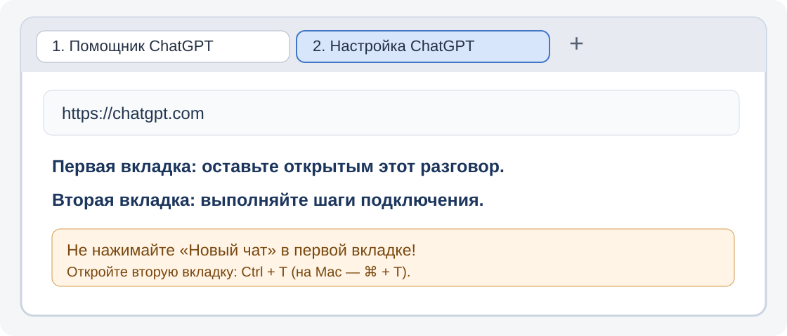

# Скриншоты подключения Далисмана

**Все 12 иллюстраций доступны в репозитории:** одна схема первого шага (SVG) и 11 скриншотов (PNG), полученных в ходе тестирования 20 ноября 2026 года.

Для ChatGPT: перед каждым действием используй соответствующий **прямой URL изображения** ниже. Если текущий чат не позволяет вывести исходную картинку непосредственно в ответе, честно сообщи об этом, дай одну ссылку на изображение и одно короткое действие. Не подменяй реальный скриншот выдуманным или случайной картинкой из поиска.

| Файл | Экран |
|---|---|
| [01-two-browser-tabs.svg](https://raw.githubusercontent.com/Dmrs1977/dalisman-chatgpt-setup/main/screenshots/01-two-browser-tabs.svg) | Две вкладки браузера — первая для помощника, вторая для настройки |
| [02-chatgpt-home.png](https://raw.githubusercontent.com/Dmrs1977/dalisman-chatgpt-setup/main/screenshots/02-chatgpt-home.png) | Главная страница и значок плагинов |
| [03-plugins-add-menu.png](https://raw.githubusercontent.com/Dmrs1977/dalisman-chatgpt-setup/main/screenshots/03-plugins-add-menu.png) | Меню «Добавить пользовательский сервер MCP» |
| [04-server-form.png](https://raw.githubusercontent.com/Dmrs1977/dalisman-chatgpt-setup/main/screenshots/04-server-form.png) | Поля названия, описания, URL и OAuth |
| [05-oauth-dcr.png](https://raw.githubusercontent.com/Dmrs1977/dalisman-chatgpt-setup/main/screenshots/05-oauth-dcr.png) | Расширенные настройки OAuth и DCR |
| [06-create-plugin.png](https://raw.githubusercontent.com/Dmrs1977/dalisman-chatgpt-setup/main/screenshots/06-create-plugin.png) | Подтверждение доверия и создание плагина |
| [07-connect-dalisman.png](https://raw.githubusercontent.com/Dmrs1977/dalisman-chatgpt-setup/main/screenshots/07-connect-dalisman.png) | Кнопка «Подключить Далисман» |
| [08-consent.png](https://raw.githubusercontent.com/Dmrs1977/dalisman-chatgpt-setup/main/screenshots/08-consent.png) | Выбор организаций и разрешений на elklp.ru |
| [09-installed.png](https://raw.githubusercontent.com/Dmrs1977/dalisman-chatgpt-setup/main/screenshots/09-installed.png) | Далисман в списке установленных |
| [10-first-prompt.png](https://raw.githubusercontent.com/Dmrs1977/dalisman-chatgpt-setup/main/screenshots/10-first-prompt.png) | Первый запрос с выбранным @Далисман |
| [11-first-report.png](https://raw.githubusercontent.com/Dmrs1977/dalisman-chatgpt-setup/main/screenshots/11-first-report.png) | Полученный недельный отчёт |
| [12-reconnect.png](https://raw.githubusercontent.com/Dmrs1977/dalisman-chatgpt-setup/main/screenshots/12-reconnect.png) | Повторное подключение уже созданного плагина |

## Первый шаг

**Никогда не путать новую вкладку браузера и новый чат ChatGPT.** Существующий разговор с помощником должен оставаться открытым.

## Важно

Скриншоты соответствуют конкретной версии интерфейса. Если интерфейс пользователя отличается, попроси его прислать скриншот и адаптируй подсказку. Не проси присылать авторизационные коды, пароли и ссылки с параметрами OAuth.
