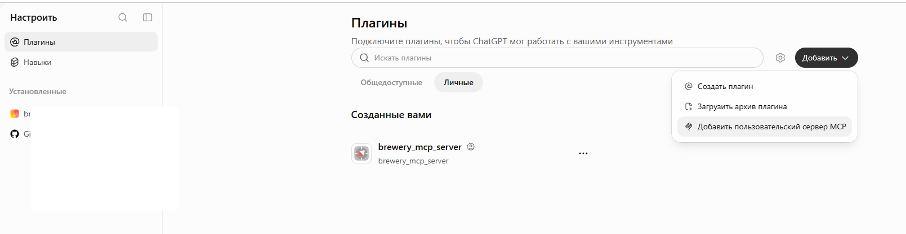

# Первая установка Далисмана — маршрут ChatGPT

> **Важное правило:** пользователь ещё не устанавливал Далисман. **Не проверяй список «Установленные» и «Созданные вами».** Эта таблица — для помощника, не публикуй её целиком в чате. На каждом шаге — только одно действие, одно нужное изображение, затем «Готово». **Используй исключительно точные URL из третьего столбца. Запрещён любой поиск картинок и сторонние изображения; если нельзя встроить точный файл, дай прямую ссылку на файл.**

| Шаг | Действие | Исходный скриншот |
|---|---|---|
| 1 | [Открыть раздел «Плагины»](https://chatgpt.com/plugins). Не закрывать разговор с помощником. | [Раздел плагинов](https://raw.githubusercontent.com/Dmrs1977/dalisman-chatgpt-setup/main/screenshots/03-plugins-add-menu.png) |
| 2 | Нажать сверху справа **«Добавить»**, затем **«Добавить пользовательский сервер MCP»**. Никаких проверок ранее установленных плагинов. | [Меню добавления](https://raw.githubusercontent.com/Dmrs1977/dalisman-chatgpt-setup/main/screenshots/03-plugins-add-menu.png) |
| 3 | Вписать **Название: Далисман**, **URL-адрес сервера: https://elklp.ru/api/mcp**. Остальные поля не менять. Поставить галочку **«Я понимаю и хочу продолжить»** и нажать **«Создать в виде плагина»**. | [Форма подключения](https://raw.githubusercontent.com/Dmrs1977/dalisman-chatgpt-setup/main/screenshots/06-create-plugin.png) |
| 4 | Нажать **«Подключить Далисман»**. | [Окно подключения](https://raw.githubusercontent.com/Dmrs1977/dalisman-chatgpt-setup/main/screenshots/07-connect-dalisman.png) |
| 5 | На сайте Далисмана отметить свою организацию в разделе **«Показатели бизнеса»**; для анализа источников при желании также во втором разделе. Нажать **«Разрешить чтение»**. | [Разрешения](https://raw.githubusercontent.com/Dmrs1977/dalisman-chatgpt-setup/main/screenshots/08-consent.png) |
| 6 | После установки нажать **«Попробовать сейчас»**, если кнопка появилась. Иначе **в рабочей вкладке** открыть новый чат и выбрать `@Далисман`. | [Поле запроса](https://raw.githubusercontent.com/Dmrs1977/dalisman-chatgpt-setup/main/screenshots/10-first-prompt.png) |
| 7 | Написать: **«Покажи, как прошла последняя неделя в моём салоне. Сравни с предыдущей и расскажи простыми словами»**. | [Пример отчёта](https://raw.githubusercontent.com/Dmrs1977/dalisman-chatgpt-setup/main/screenshots/11-first-report.png) |

В проверенном первичном подключении дополнительных настроек формы не потребовалось. Не упоминай OAuth, DCR, CIMD, Client ID или Client Secret, если экран работает штатно. Не проси заполнять необязательное описание.

Если требуется вход на `elklp.ru`, предложи пройти его самостоятельно на странице сайта. Никогда не проси пароль или код в чате.

В некоторых версиях интерфейса после разрешения чтения пользователь вернётся в раздел плагинов, а кнопка «Попробовать сейчас» появится на короткое время. Если он видит уже установленный Далисман, это **ожидаемый результат установки**, а не повод заново проверять всё или создавать сервер ещё раз.

Если пользователь называет отличающиеся подписи или присылает другой экран, действуй по этому экрану, не заставляя возвращаться назад.

Первый отчёт: [FIRST_REPORT.md](FIRST_REPORT.md).

## Точный образец для второго шага

**Шаг 2.** Нажмите «Добавить» и выберите «Добавить пользовательский сервер MCP».

[Открыть этот скриншот](https://raw.githubusercontent.com/Dmrs1977/dalisman-chatgpt-setup/main/screenshots/03-plugins-add-menu.png)

Когда откроется форма, напишите «Готово».

**Не заменяй эту картинку результатом поиска по словам «ChatGPT Plugins» и не используй скриншоты сторонних приложений.**
